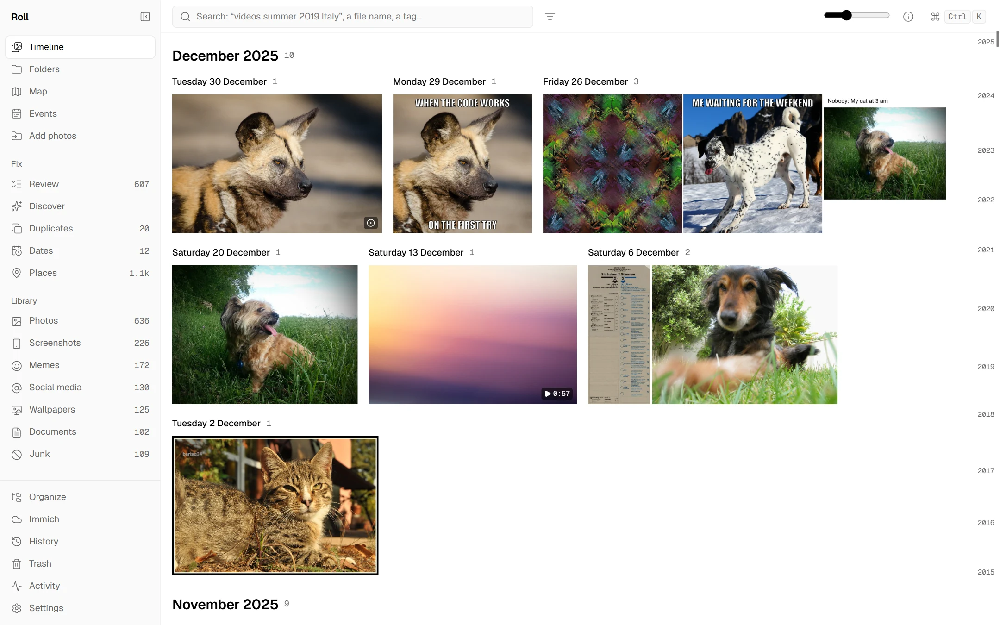
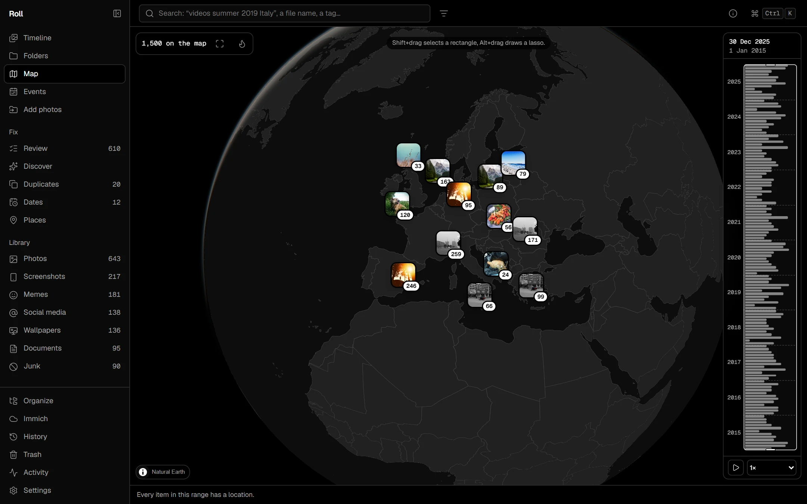
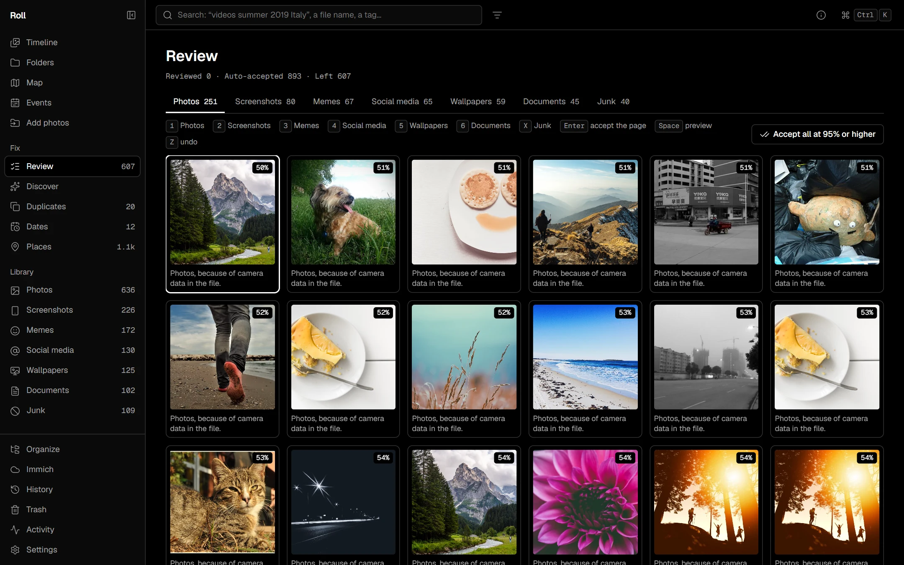
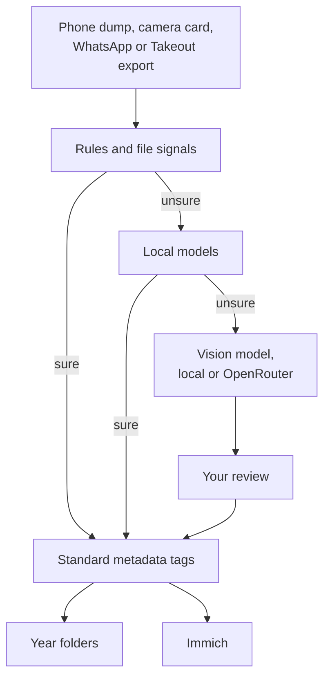
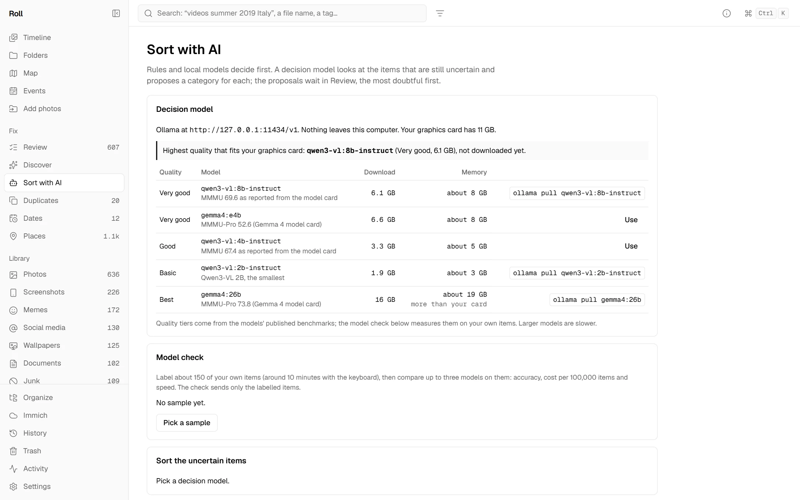

<div align="center">

<picture>
  <source media="(prefers-color-scheme: dark)" srcset="docs/screenshots/logo-dark.svg">
  
</picture>

# Roll

**Your camera roll, sorted. On your PC, by year, with nothing lost.**

A local photo and video library that turns a phone dump of 100,000+ files
into a clean archive: photos and events by year, screenshots, memes and
documents out of the way, dates and places fixed in bulk, and only the good
stuff synced to Immich.

[](https://github.com/mrghxst/roll/actions/workflows/ci.yml)


[](LICENSE)

</div>



## What it does

<table>
<tr>
<td width="50%" valign="top">

**Sorts itself.** Rules, file signals and local models put every item in a
category: photos, screenshots, memes, social media saves, wallpapers,
documents, junk. Only the uncertain rest goes to a vision model, and you
review its proposals in a keyboard-first grid.

</td>
<td width="50%" valign="top">

**A real archive on disk.** `2023/Photos`, `2023/2023-07 Lake Garda`,
`2023/Screenshots`. Plain folders you can open in Explorer, rebuilt from
standard metadata tags at any time.

</td>
</tr>
<tr>
<td valign="top">

**Fixes dates and places in bulk.** A wrong camera clock is corrected from
one reference photo. Missing places come from nearby photos, your location
history, or a drop on the map.

</td>
<td valign="top">

**A curated Immich.** Immich gets what you pick for your phone and for
sharing, by default your photos and events, and Roll keeps it in sync:
later fixes, albums and shared albums.

</td>
</tr>
</table>

<table>
<tr>
<td width="50%"></td>
<td width="50%"></td>
</tr>
<tr>
<td align="center"><sub>A globe with a time slider. Drag items without a place onto it.</sub></td>
<td align="center"><sub>Review proposals with the keyboard, the most doubtful first.</sub></td>
</tr>
</table>

## How an item gets sorted



Every step writes standard metadata tags first. Folders and Immich follow
the tags, so nothing is ever only in Roll's database.

## Safe by design

- **Never loses anything.** No permanent deletes, and every change can be
  undone from History.
- **Never re-encodes your originals.** Roll changes metadata, and only
  after showing you what will change.
- **Works in place.** Your folders stay where they are and readable without
  Roll.
- **Private by default.** Nothing leaves your PC unless you turn it on, one
  switch per kind of traffic. API keys live in the system keychain, never
  in the app's web view.

## AI, local or for cents



- **Local and free.** Ollama, LM Studio or llama.cpp. Roll lists vision
  models by quality with their download size and memory, and says which is
  the best one that fits your graphics card.
- **Or cloud for cents.** OpenRouter with zero data retention, roughly
  $0.30–2.50 per 100,000 items, with an estimate before every run and a
  hard budget cap. Cloud models are listed with their price per 100,000
  items and how the provider handles your data.
- **Only what's needed leaves.** 512 px thumbnails without metadata, only
  for uncertain items, only when you allow it.
- **Measured, not guessed.** The model check compares models on about 150
  of your own items. On a public test set of 157 labelled images,
  `qwen3-vl:8b-instruct` running locally on an RTX 2080 Ti sorted
  **95.5%** correctly ([benchmarks](docs/benchmarks.md)).

## Status

In active development. Working today:

| | |
|---|---|
| Library | Timeline, folders, filters, search, viewer for photos and videos, 100k items at 60 fps |
| Sorting | Rules, categories, review, organize into year folders with undo; duplicates merged in bulk, best shots of bursts and series |
| Fixing | Camera clock and time zone fixes, places from neighbours and location history, map with time slider |
| Import | Camera cards, WhatsApp and Google Takeout exports |
| On this computer | SigLIP 2 image model: sorting (68% on its own at 97% precision on the test set), search by what a picture shows, Teach, Find similar, look-alike groups; text reader for screenshots and documents; faces grouped into people you name, written into the files for Immich |
| AI | Local and OpenRouter decision models, budget caps, model check, "ask AI" in search, best matches with better ranking |
| Sync | Immich sync with albums and shared albums, checked against a real Immich 3.3.1 |
| Install | Windows installer (per user, ExifTool and FFmpeg bundled), dmg, AppImage and deb: [releases](https://github.com/mrghxst/roll/releases) |

Next: cluster names from a model, faces for picking best shots, and
signed builds with updates.
[docs/plan.md](docs/plan.md) tracks every milestone; [PROMPT.md](PROMPT.md)
is the full spec.

## Build and run

Needs Rust (stable), Node.js with pnpm, and ExifTool and FFmpeg on the
PATH for development builds.

```bash
git clone https://github.com/mrghxst/roll
cd roll/apps/desktop
pnpm install
pnpm tauri dev
```

The Windows installer bundles ExifTool and FFmpeg:

```powershell
pwsh scripts/fetch-tools.ps1
cd apps/desktop; pnpm tauri build --config src-tauri/tauri.bundle.json
```

To try the interface without a library, run `pnpm dev` and open
`http://localhost:1420/?setup=1&mock=2000`: a mock backend with generated
items.

## Documentation

- [User guide](docs/user-guide.md): how to use the app
- [Immich](docs/immich.md): what Roll writes and how it syncs
- [Decisions](docs/decisions.md): where and why the build differs from the spec
- [Benchmarks](docs/benchmarks.md): speed and model accuracy
- [Research](docs/research.md): AI prices, Immich compatibility, a survey of a real library
- [CLAUDE.md](CLAUDE.md): layout and commands for working on the code

## Stack

Tauri 2, Rust, Svelte 5, SQLite, ONNX Runtime, ExifTool, FFmpeg and
MapLibre with Natural Earth outlines (OpenFreeMap detail tiles optional).

## License

MIT. The screenshots show the mock backend with public-domain images from
[Openverse](https://openverse.org) (CC0 and Public Domain Mark) and images
rendered by `tools/cc0`; none are from a real library.
